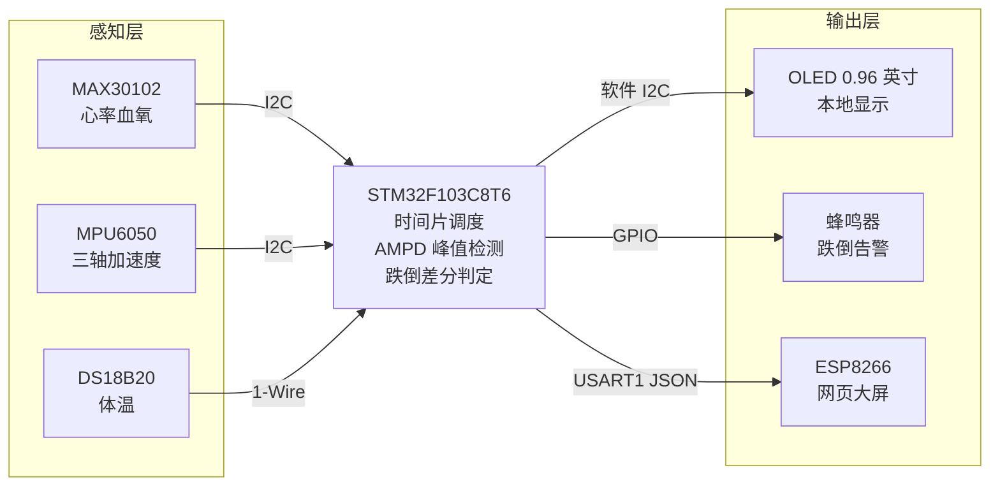

# 基于 STM32 的多维生理特征与跌倒预警监测系统


一款面向独居人群日常安全看护的便携式健康监测设备。以 STM32F103C8T6 为主控，同步采集**心率、血氧、体温、三轴姿态**四类体征，本地 OLED 实时显示，并通过串口以 JSON 格式向 ESP8266 输出数据，配合网页端大屏实现远程查看；检测到跌倒冲击时蜂鸣器立即声光告警。

> 本仓库为本科毕业设计成果，含完整嵌入式工程与论文/开题/答辩文档。

---

## 1. 功能特性

| 功能 | 实现方式 |
| --- | --- |
| 心率 / 血氧测量 | MAX30102 光电传感器 + AMPD 峰值检测算法，解算心率与 SpO₂ |
| 接触式体温 | DS18B20 单总线数字温度传感器，分辨率 0.0625 ℃ |
| 跌倒检测 | MPU6050 三轴加速度**差分平方和**动态阈值判定 |
| 本地显示 | 0.96" SSD1306 OLED（128×64），六行实时刷新 |
| 声学告警 | 有源蜂鸣器，检测到跌倒冲击即鸣响 |
| 远程数据 | USART1 输出标准 JSON 帧，交由 ESP8266 转发至网页大屏 |
| 任务调度 | 基于 1 ms 系统滴答的**非阻塞时间片轮转**框架 |

## 2. 系统架构



所有外设统一 3.3 V 供电并共地。三个 I²C 从设备**各自独占一条**独立的软件模拟 I²C 总线（OLED 走 PB6/PB7，MAX30102 走 PB8/PB9，MPU6050 走 PB10/PB11），把刷屏总线与采集总线在物理层面隔开，从根本上避免多路高频通信争抢同一条总线造成的时序冲突。

## 3. 硬件设计

### 3.1 引脚分配

| 外设 | 型号 | 接口 | 引脚 | 备注 |
| --- | --- | --- | --- | --- |
| 主控 | STM32F103C8T6 | — | — | Cortex-M3 @ 72 MHz，64 KB Flash / 20 KB RAM |
| 体温传感器 | DS18B20 | 1-Wire | **PA0** | DQ 需 4.7 kΩ 上拉 |
| 蜂鸣器 | 有源蜂鸣器 | GPIO 推挽 | **PA1** | 低电平鸣响，初始化即置高防误响 |
| OLED 屏 | SSD1306 0.96" | 软件 I²C | **PB6** SCL / **PB7** SDA | 独立总线，仅刷屏 |
| 心率血氧 | MAX30102 | 软件 I²C | **PB8** SCL / **PB9** SDA | INT 悬空，靠定时轮询读 FIFO |
| 六轴惯性 | MPU6050 | 软件 I²C | **PB10** SCL / **PB11** SDA | 从机地址 `0x68`（AD0 接地） |
| 无线模块 | ESP8266 | USART1 | **PA9** TX / **PA10** RX | 115200-8-N-1，引脚交叉连接 |

### 3.2 关键配置

- **MAX30102**：采样率 100 Hz，ADC 量程 4096 nA，脉宽 400 µs，FIFO 不翻转、不做平均，由主循环每 10 ms 读取一次（与 100 Hz 采样节奏对齐）。
- **MPU6050**：加速度量程 **±2 g**（16384 LSB/g，以换取跌倒判定的灵敏度），陀螺仪 ±2000 °/s，DLPF 使能，`SMPLRT_DIV=7` 使输出频率为 1 kHz / 8 ≈ **125 Hz**，与主循环 50 Hz 的读取节奏相匹配。
- **DS18B20**：12 位转换，单次转换约 750 ms，读取后按 0.0625 ℃ 换算并以「值×10」的整数形式回传。

## 4. 软件设计

### 4.1 时间片轮转调度

主循环不使用任何阻塞延时，而是围绕 `g_system_tick`（SysTick 1 ms 累加）为每个任务划分独立时间窗口。这样单核 MCU 也能获得近似并发的执行效果，避免某一外设长时间霸占总线导致高频采样断层。

| 任务 | 周期 | 执行内容 |
| --- | --- | --- |
| MAX30102 采集与解算 | **10 ms** | 读取 FIFO 原始红光/红外数据，送入 AMPD 算法输出心率与 SpO₂ |
| MPU6050 跌倒判定 | **20 ms** | 读取三轴加速度，计算变化率，越限则置跌倒标志并鸣响蜂鸣器 |
| 串口上报 | **100 ms** | 将当前全部体征封装为一帧 JSON 发送至 ESP8266 |
| OLED 刷新 | **500 ms** | 局部覆写六行显示内容（末行填充空格防残影） |
| DS18B20 测温 | **2000 ms** | 启动并读取一次体温转换结果，同时复位跌倒告警状态 |

> 说明：本表以**当前代码实际实现**为准。论文正文中记载的空闲窗口（如屏幕 100 ms、体温 1000 ms）为早期方案，后经调试调整为上表数值。

### 4.2 跌倒检测算法

传统做法直接比对当前合加速度与固定阈值，但该值始终含 1 g 静态重力分量，导致阈值难设定、日常姿态转换易误报。本项目转而衡量**相邻采样周期的瞬态冲击**，构建空间加速度差分平方和：

```
S = (Δax/16384)² + (Δay/16384)² + (Δaz/16384)²
```

其中 `Δax, Δay, Δaz` 为相邻两个 20 ms 采样周期内三轴读数的差值，`16384` 为 ±2 g 量程下 1 g 对应的原始刻度。当 `S > 0.5 g²` 时判定为跌倒，置 `is_falling` 标志、点亮 OLED 底部状态行并驱动蜂鸣器。采用差分而非绝对值，使算法只对"突变"敏感、对"静止姿态"免疫。

### 4.3 心率血氧算法（AMPD）

AMPD（Automatic Multiscale-based Peak Detection）通过多尺度小波包络对脉搏波做自适应寻峰，无需人工设定阈值即可适应不同个体的波形差异。血氧饱和度由双波长吸收率之比推算：

```
R = (AC_red / DC_red) / (AC_ir / DC_ir)
```

`R` 代入经验校准曲线后得到 SpO₂ 百分比。当红外原始值低于 10000 时判定为**手指未佩戴**，前端与 OLED 同步切换为 `---` 占位，避免漏光导致的数值乱跳。

## 5. 串口数据协议

STM32 每 100 ms 通过 USART1（115200, 8N1）输出一行 UTF-8 JSON，以换行符 `\n` 作为帧边界：

```json
{"Temp":36.5,"HR":76,"SpO2":98,"AX":-1024,"AY":2048,"AZ":15872,"Fall":0,"Finger":1}
```

| 字段 | 类型 | 含义 |
| --- | --- | --- |
| `Temp` | float | 体温，℃ |
| `HR` | int | 心率，bpm |
| `SpO2` | int | 血氧饱和度，% |
| `AX` / `AY` / `AZ` | int | 三轴加速度原始值（±2 g，16384 ≈ 1 g） |
| `Fall` | int | 跌倒标志：`1` 跌倒 / `0` 正常 |
| `Finger` | int | 手指佩戴状态：`1` 在位 / `0` 未佩戴 |

无 ESP8266 时，直接用串口助手（如 SSCOM / Vofa+）打开对应 COM 口即可查看数据，便于先验证传感器链路。

## 6. 目录结构

```
STM32-Health-Monitor/
├── User/              # 主程序 main.c、中断服务、外设配置汇总
├── Hardware/          # 各外设驱动（OLED / MPU6050 / MAX30102 / DS18B20 / 蜂鸣器 / 串口）
│   └── ampd_algo.c    # AMPD 心率血氧解算算法
├── Library/           # STM32F10x 标准外设库（SPL）
├── Start/             # 启动文件、CMSIS 内核文件与寄存器定义
├── RTE/               # Keil 运行环境与调试器配置
├── Docs/              # 毕业论文、开题报告、答辩 PPT
├── Project.uvprojx    # Keil MDK 工程文件
└── README.md
```

> `Objects/`、`Listings/`、`DebugConfig/` 与 `*.uvoptx`、`*.uvguix.*` 均为本机编译产物或个人窗口布局，已通过 `.gitignore` 排除，首次编译时由 Keil 自动生成。

## 7. 编译与烧录

1. 安装 **Keil MDK 5**（uVision5）及 `Keil.STM32F1xx_DFP` 器件支持包。
2. 打开根目录下的 **`Project.uvprojx`**。
3. 确认 Target 器件为 `STM32F103C8`，时钟配置 72 MHz。
4. `Build`（F7）编译，随后通过 ST-Link / DAP-Link `Download`（F8）烧录。
5. 上电后 OLED 应立即显示六行数据；串口助手可见 JSON 帧持续输出。

> 若 Keil 编辑器中文注释显示为乱码，请在 `Edit → Configuration → Editor → Encoding` 中选择 `UTF-8`（工程源文件均为 UTF-8 编码）。

## 8. 实测结果

与商用健康手环在静息状态下同步采集 10 组对照数据：

- **心率**：相对偏差最大 8.45 %，整体控制在 10 % 以内；
- **血氧**：相对误差始终低于 3.13 %；
- **跌倒判定**：模拟失重与撞击时蜂鸣器均能及时触发，OLED 状态行同步更新。

详细数据与图表见 `Docs/` 下的毕业论文第 5 章。

## 9. 已知限制

诚实记录当前版本尚未解决的问题，便于后续迭代：

- 跌倒判定仅依据单次 20 ms 加速度差分，未引入姿态角、持续时间与二次确认，剧烈运动（如快速起坐、跑跳）仍可能误报；
- 跌倒告警在体温任务的 2 s 周期内自动复位，缺少"持续报警 + 人工确认解除"机制；
- ESP8266 端固件（串口转 WebSocket 服务）与网页大屏前端源码**未包含在本仓库**，本仓库仅负责 STM32 侧的 JSON 输出；
- 串口发送采用阻塞轮询并等待 `USART_FLAG_TC`，未使用 DMA，报文较长时会轻微占用主循环时间；
- 设备为原型验证形态，尚未做低功耗管理与锂电池充放电保护。

## 10. 文档

| 文件 | 说明 |
| --- | --- |
| [毕业论文](Docs/基于STM32的人体健康监测系统_毕业论文.docx) | 完整设计与实现，含硬件原理、算法推导、测试数据 |
| [开题报告](Docs/开题报告.docx) | 课题背景、研究现状与总体方案 |
| [答辩 PPT](Docs/毕设答辩PPT.pptx) | 答辩汇报用演示文稿 |

---

**作者**：王家特 · 电子信息工程 · 2026 届

本仓库用于记录本科毕业设计的过程与成果。如对其中思路有疑问或建议，欢迎提 Issue 交流。